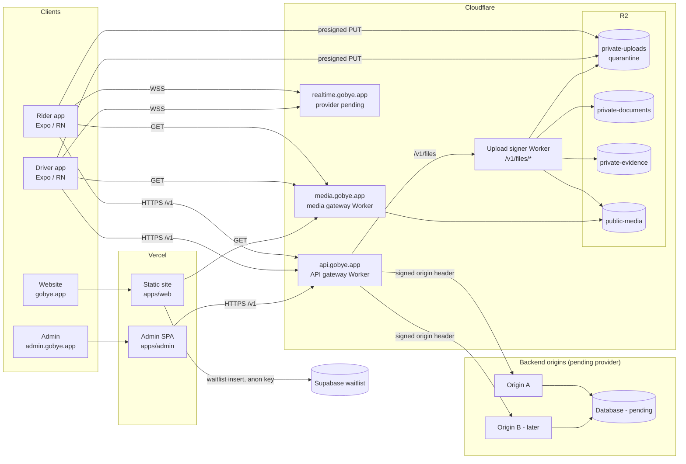

# Infrastructure architecture (D-051)

How GoBye's apps, website, admin, edge and (future) backend fit together. The rule that drives every part:
**clients only know stable public addresses; which provider serves them is edge configuration.** Moving or
adding a backend never needs a new app build or a website redeploy.

Nothing below is deployed. See the status table at the end.

## Picture

Text version: website and admin are static builds on **Vercel** (DNS-only records, no Cloudflare proxy in
front). Apps and admin call **`https://api.gobye.app/v1`**, a Cloudflare Worker gateway that picks a healthy
origin under the current traffic policy. File bytes never pass through a Worker: apps upload straight to the
R2 quarantine bucket with a short presigned URL, then the signer verifies, scans and moves the file. Public
media is served by a Worker bound to the public bucket only. Realtime has its own host; provider pending.

## Parts

| Part | Where in the repo | Responsibility |
|---|---|---|
| Public config | `packages/core/src/infra/env.ts`, `apps/*/src/state/publicConfig.ts` | One typed place for API, realtime and media URLs per environment; refuses secrets and production mocks |
| API client | `packages/core/src/infra/http.ts`, `errors.ts`, `idempotency.ts` | Request ids, timeouts, idempotency keys, safe retries, ambiguous-write lookup (API_CLIENT.md) |
| Service interfaces + mocks | `packages/core/src/services/types.ts`, `mocks/services.ts` | Apps depend on interfaces; HTTP implementations replace mocks later |
| API gateway | `infra/cloudflare/src/workers/api-gateway` | Routing, header hygiene, limits, rate limits, origin auth, failover (API_GATEWAY.md) |
| Traffic model | `packages/core/src/traffic` | Origins, policies, health hysteresis, privileged changes (LOAD_BALANCING_FAILOVER.md, TRAFFIC_SWITCHING.md) |
| Files | `packages/core/src/files`, `infra/cloudflare/src/workers/upload-signer`, `src/r2` | Classes, validation, lifecycle, presign, scan, access (R2_STORAGE_ARCHITECTURE.md) |
| Public media | `infra/cloudflare/src/workers/media-gateway` | Public bucket only, immutable caching |
| Realtime client | `packages/core/src/infra/realtime.ts` | Reconnect, dedupe, ordering, resync; transport pluggable (REALTIME_ARCHITECTURE.md) |
| Observability | `packages/core/src/infra/observability.ts` | Structured logs with redaction, metrics, provisional alert policies (MONITORING_OBSERVABILITY.md) |
| Edge config | `infra/cloudflare/r2/*`, `dns/*`, `load-balancer/*`, `wrangler.*.toml` | Definitions and proposals only (CLOUDFLARE_SETUP.md, NETWORK_ARCHITECTURE.md) |
| Web hosting | `apps/web/vercel.json`, `apps/admin/vercel.json` | Security headers, caching (VERCEL_CONFIGURATION.md) |
| Admin traffic page | `apps/admin/src/workspaces/infrastructure` | Simulated change flow with approvals and audit |
| Demo relay (separate) | `tools/demo-relay`, `packages/core/src/relay` | Connected demo on test data only (D-049). Not part of production |

## Environments

| | Development | Staging (proposed) | Production (proposed) |
|---|---|---|---|
| Website | localhost / Vercel preview | Vercel preview or `staging.gobye.app` | `gobye.app`, `www.gobye.app` (Vercel) |
| Admin | `npm run admin` | `admin-staging.gobye.app` | `admin.gobye.app` (Vercel) |
| API | `http://localhost:8787/v1` | `https://api-staging.gobye.app/v1` | `https://api.gobye.app/v1` |
| Buckets | none / fakes | `gobye-staging-*` | `gobye-prod-*` |
| Secrets | personal test keys | staging Worker secrets | production Worker secrets |
| Mocks | on | allowed per test | refused (`parsePublicConfig`) |

Staging and production never share buckets, secrets or origins. Hostnames are proposals until approved (Q-070).

## Status per component

| Component | Code | Tested locally | Staging | Production |
|---|---|---|---|---|
| Public config + secret detection | Implemented | Yes (jest) | — | — |
| API client, error model, idempotency | Implemented | Yes (jest) | — | — |
| Realtime client | Implemented | Yes (mock transport) | Pending provider selection | — |
| Logging, metrics, alerts | Implemented (interfaces + memory sinks) | Yes | Pending provider selection | — |
| File service, validation, lifecycle | Implemented | Yes (mock store) | Pending database + scanner | — |
| SigV4 presigner | Implemented | Yes (AWS vector) | Pending credentials | — |
| Upload signer Worker | Implemented | Yes (R2 fake) | Pending credentials, backend, scanner | — |
| Media gateway Worker | Implemented | Yes | Pending DNS approval | — |
| API gateway Worker | Implemented | Yes (simulated origins) | Pending backend origin | — |
| Traffic model + change rules | Implemented | Yes | — | — |
| Admin traffic page | Implemented | Yes (logic) | **Simulated** | — |
| R2 buckets, CORS, lifecycle | Configured (definitions) | JSON only | Pending credentials | — |
| DNS records | Proposed | — | Pending approval | Pending approval |
| Load balancer | Proposed templates | — | — | Future enhancement (paid, needs second origin) |
| Vercel headers (web, admin) | Configured | Yes (Chromium with headers applied) | Pending deployment | Pending deployment |
| Backend, database, auth | — | — | Pending provider selection | — |

Nothing is "verified in production". Tests here prove logic against fakes, not real Cloudflare behaviour.
