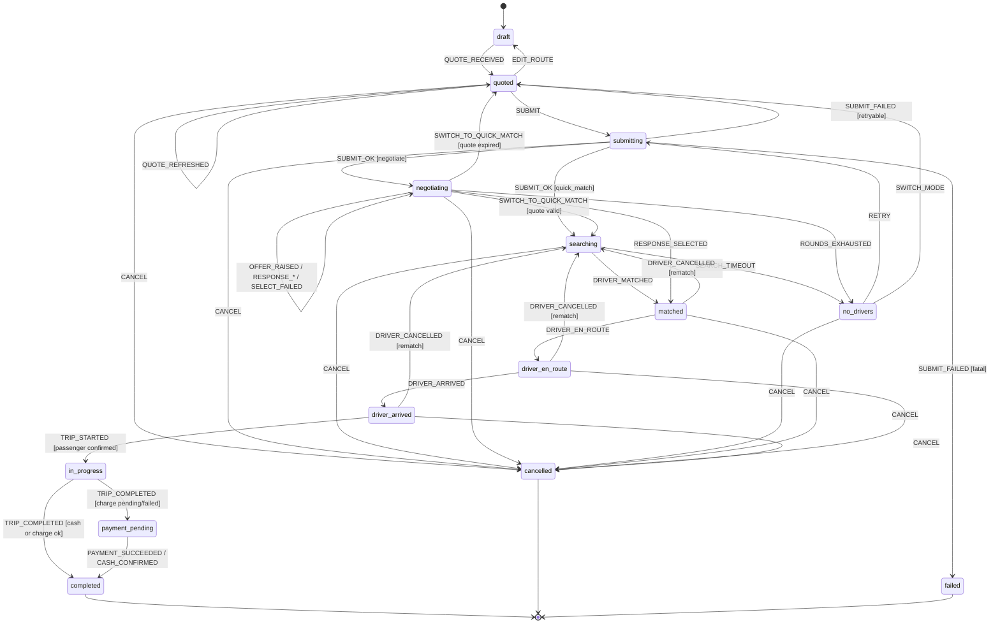
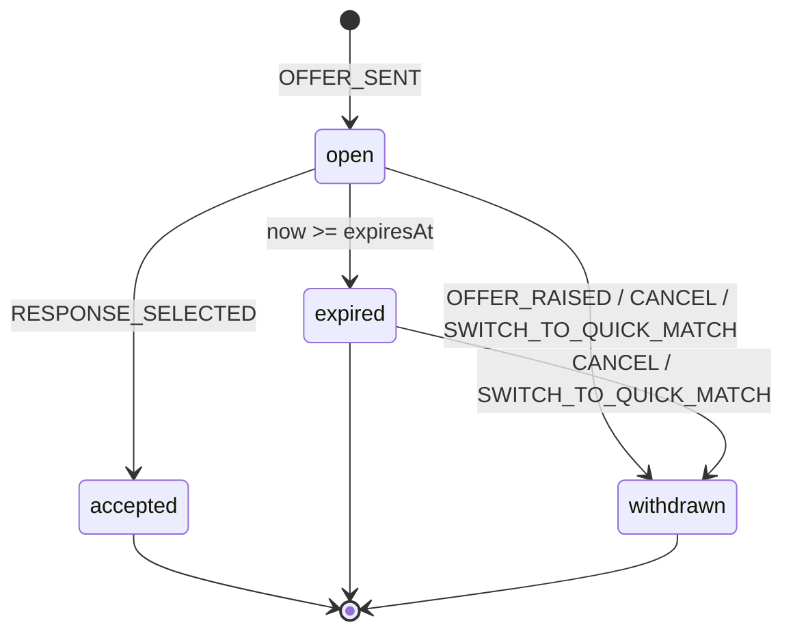
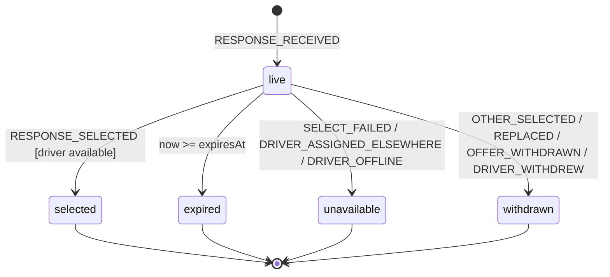
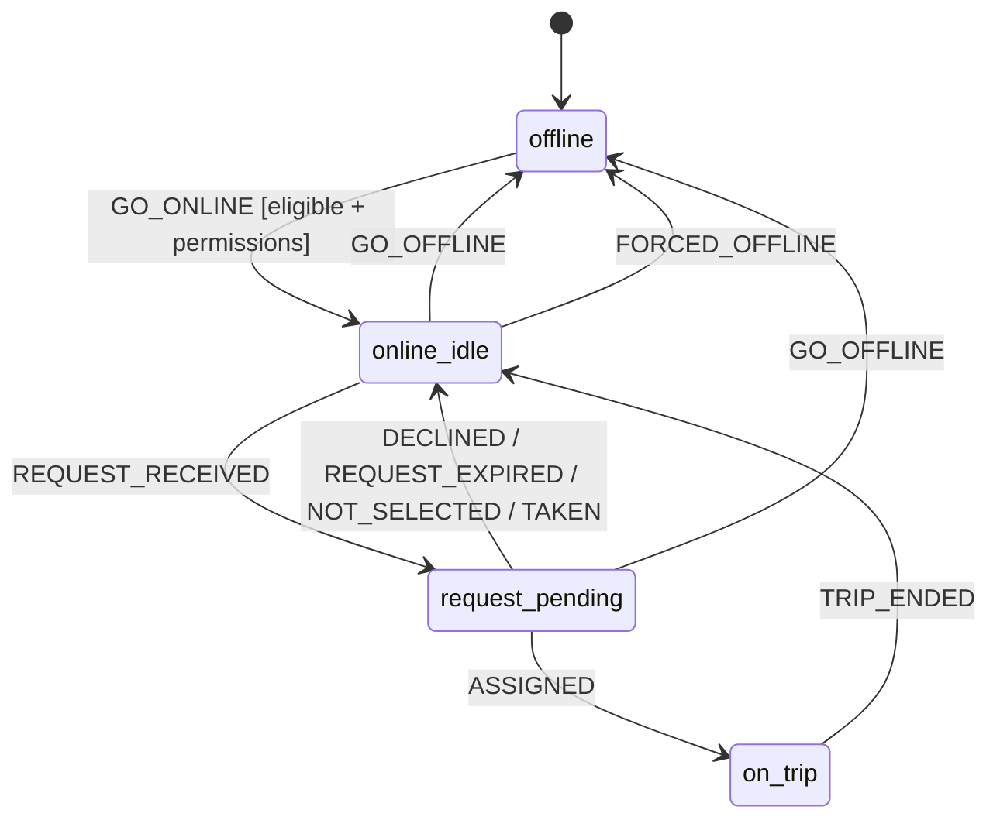
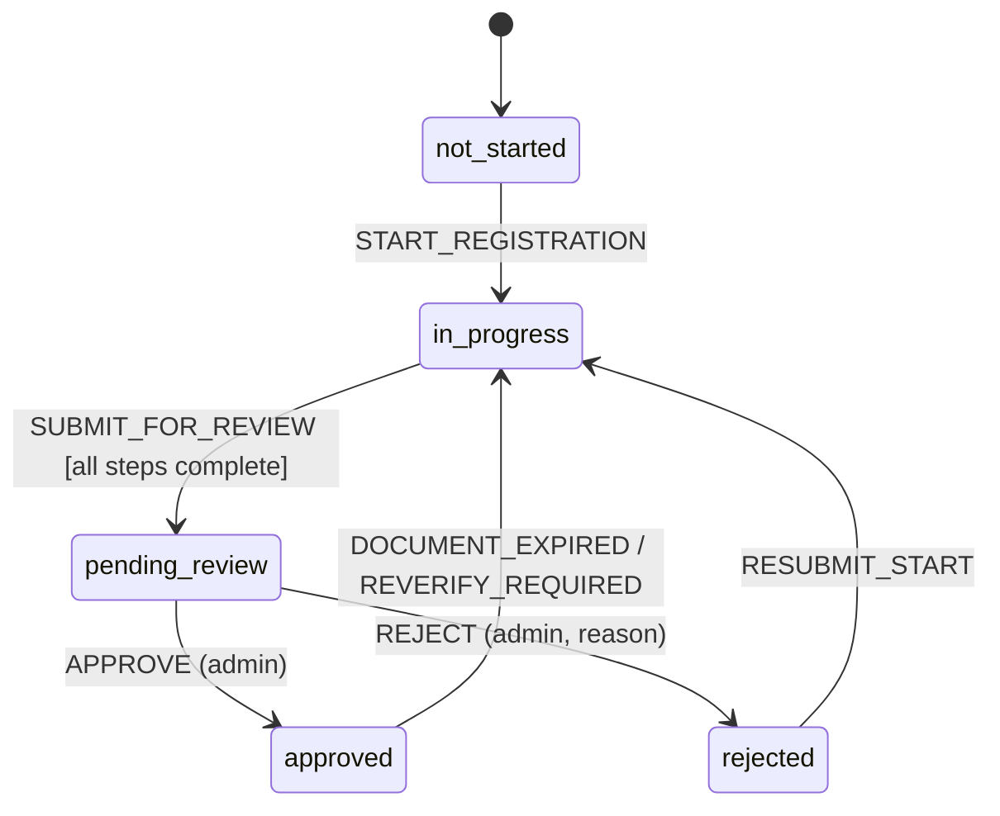

# GoBye — UI States & State Machines

**Status:** Draft, 2026-10-21. Specification for `@gobye/core` reducers (`bookingReducer`, negotiation helpers) and screen states. Not implemented unless `SCREEN_INVENTORY.md` says so. Statuses and types from `DATA_MODELS.md`; rules from `BUSINESS_RULES.md`; values are mock.

Principles:
1. **Illegal transitions are rejected** — state returned unchanged with an error flag (ARCHITECTURE §2.4; T-AU-013).
2. **Expiry is derived**, never stored by timers: `isExpired = expiresAt <= now` (ARCHITECTURE §4). "Expired" events below are the derivation point, not a timer mutation.
3. **Server wins.** In production, server events/state override local state on conflict (NFR-REL-002).
4. Event names are proposed reducer action types; final names follow the code (`DATA_MODELS.md` rule: code wins, docs updated in the same change).

---

## 1. Generic UI states & copy guidance

Copy style: sentence case, plain English, say what happened and what to do next; no blame, no error codes in main text (an optional short reference may follow), no exclamation marks for errors. Money in `₦` format (BR-003). Anything simulated says "Simulated".

| State | When | Visual pattern | Copy guidance | Example | A11y |
|---|---|---|---|---|---|
| **Loading** | Waiting > 300 ms | Skeleton for content; spinner on buttons (button keeps label, disabled) | Describe the activity when > 2 s | "Finding drivers near you…" | `accessibilityState.busy`; announce once |
| **Empty** | No data, not an error | Icon + title + one sentence + optional action | Say why empty and how to fill it | "No rides yet. Your trips will appear here." | Text readable; action is a button |
| **Error** | Request failed | Inline (field) or block with Retry | What failed + what to do | "We couldn't load prices. Check your connection and try again." | Announce; move focus to message |
| **Offline** | No connectivity | Persistent banner top of screen; network actions disabled with reason | State fact + effect | "You're offline. Booking needs a connection." | Banner announced once |
| **Active** | In-progress process (searching, offer open, trip) | Status header + progress/countdown + primary action | Present tense, specific | "Offer open · 1:12 left" | Countdown announced at state change and 10 s left only |
| **Disabled** | Action not currently allowed | Reduced-emphasis control **plus** reason text (not colour alone) | Explain the condition | "Raise disabled — maximum 3 rounds reached" | `accessibilityState.disabled`; reason in hint |
| **Success** | Action completed | Check icon + confirmation; auto-advance where natural | Confirm outcome | "Payment received" | Announce; haptic success (if enabled) |
| **Cancelled** | User/driver/system cancelled | Neutral tone; fee (if any) shown | Who cancelled + any fee | "Ride cancelled. No fee was charged." | Announce |
| **Expired** | Quote/offer/response time ran out | Greyed card + "Expired" label; refresh/raise action | What expired + next step | "Your offer expired. Raise it, switch to Quick Match, or cancel." | Not selectable; label includes "expired" |

Simulated label: "Simulated" chip next to ETAs, driver positions, payments and verification outcomes while `isSimulated: true`.

---

## 2. Booking state machine (`BookingStatus`)

`cancelled` is also reached by `DRIVER_CANCELLED [no rematch]` and `SYSTEM_CANCELLED` (backend) from `matched`–`driver_arrived`. `failed` is reachable from any non-terminal state via `FATAL_ERROR` (unrecoverable server error, e.g. booking not found). Diagram omits these for readability; the table is authoritative.

### 2.1 Transition table

| # | Event | From | To | Guard / effect |
|---|---|---|---|---|
| B1 | `QUOTE_RECEIVED` | draft | quoted | Pickup, destination, route, category set; stores `quote` |
| B2 | `EDIT_ROUTE` | quoted | draft | Pickup/destination/category changed; quote discarded |
| B3 | `QUOTE_REFRESHED` | quoted | quoted | Replaces expired/old quote |
| B4 | `SUBMIT` | quoted | submitting | Quote not expired (BR-022); payment method set; mode set; negotiate: offer valid (BR-040/041); no submission in flight (BR-033); new idempotency key |
| B5 | `SUBMIT_OK` | submitting | searching | `mode = quick_match`; sets `fareLockedAt`, `agreedFare = quote.suggested` (BR-031) |
| B6 | `SUBMIT_OK` | submitting | negotiating | `mode = negotiate`; offer round 1 open |
| B7 | `SUBMIT_FAILED` | submitting | quoted | Retryable (network, timeout, quote expired server-side) |
| B8 | `SUBMIT_FAILED` | submitting | failed | Non-retryable (e.g. account blocked) |
| B9 | `DRIVER_MATCHED` | searching | matched | Sets `driver`; driver not on another active trip (BR-047) |
| B10 | `SEARCH_TIMEOUT` | searching | no_drivers | 60 s elapsed (BR-032) |
| B11 | `RETRY` | no_drivers | submitting | `mode = quick_match`; quote valid; new idempotency key |
| B12 | `SWITCH_MODE` | no_drivers | quoted | User picks Negotiate (or QM after negotiation) — back to options with mode set |
| B13 | `OFFER_RAISED` | negotiating | negotiating | New amount > current, ≤ max; round < maxRounds (BR-048/049); see §3 |
| B14 | `RESPONSE_RECEIVED` / `RESPONSE_EXPIRED` / `RESPONSE_WITHDRAWN` | negotiating | negotiating | See §4 |
| B15 | `RESPONSE_SELECTED` | negotiating | matched | Response live; server confirms driver available; sets `agreedFare`, `driver`, `fareLockedAt`; others withdrawn (BR-046) |
| B16 | `SELECT_FAILED` | negotiating | negotiating | Driver unavailable (BR-047); response → `unavailable`; error message |
| B17 | `ROUNDS_EXHAUSTED` | negotiating | no_drivers | Final round offer expired with no live responses |
| B18 | `SWITCH_TO_QUICK_MATCH` | negotiating | searching | Quote valid; open offer withdrawn; fare = suggested |
| B19 | `SWITCH_TO_QUICK_MATCH` | negotiating | quoted | Quote expired → must refresh |
| B20 | `DRIVER_EN_ROUTE` | matched | driver_en_route | Server/trip service event |
| B21 | `DRIVER_ARRIVED` | driver_en_route | driver_arrived | Driver marked Arrived (BR-090); starts wait timer (BR-081) |
| B22 | `TRIP_STARTED` | driver_arrived | in_progress | Passenger confirmed (name; PIN per Q-010) |
| B23 | `TRIP_COMPLETED` | in_progress | completed | Cash, or digital charge succeeded. *(Current code, 2026-10-21: not used — `TRIP_COMPLETED` always goes to `payment_pending` (B24), and the charge result then completes the booking. Cash is disabled, D-023.)* |
| B24 | `TRIP_COMPLETED` | in_progress | payment_pending | Digital charge pending or failed (BR-103). Code: sets `completedAt`, `paymentStatus: 'pending'`, and `awaitingPaymentAction = true` for bank transfer (wallet is charged immediately) |
| B25 | `PAYMENT_SUCCEEDED` / `CASH_CONFIRMED` | payment_pending | completed | Retry succeeded or switched to cash and driver confirmed. Code event: `PAYMENT_RESULT { status: 'paid' }` → completed; `{ status: 'failed' }` → stays `payment_pending` with `paymentStatus: 'failed'`. Payment sub-states: §2.3 |
| B26 | `CANCEL` | quoted, submitting, searching, negotiating, no_drivers, matched, driver_en_route, driver_arrived | cancelled | Fee computed per BR-080/081 and **shown before confirm**; reason optional (BR-083). From `quoted` no server call. From `submitting`, cancel is sent with the booking's idempotency key after the create resolves |
| B27 | `DRIVER_CANCELLED` | matched, driver_en_route, driver_arrived | searching | Rematch policy enabled (Q-030); no fee to passenger |
| B28 | `DRIVER_CANCELLED` | matched, driver_en_route, driver_arrived | cancelled | Rematch disabled or rider declines |
| B29 | `SYSTEM_CANCELLED` | searching…driver_arrived | cancelled | Backend cancels (e.g. safety, account action) |
| B30 | `FATAL_ERROR` | any non-terminal | failed | Unrecoverable |
| B31 | `RESET` | completed, cancelled, failed | draft | New booking; persisted key deleted |

**Rejected (examples):** `CANCEL` from `in_progress`, `payment_pending`, `completed`; `TRIP_STARTED` from `driver_en_route`; `SUBMIT` while `submitting`; `RESPONSE_SELECTED` on expired response; `OFFER_RAISED` with lower amount.

Note: `BUSINESS_RULES.md` §9 says cancellation is reachable "before `in_progress` completes"; this document restricts rider cancellation to states **before** `in_progress`. Mid-trip termination (safety) is a support/backend action — reconcile wording (Q-033).

### 2.2 Screen mapping

| Status | Rider screen | Primary UI |
|---|---|---|
| draft | R07/R08/R09 (quoting) | Search, route preview, "Getting prices…" |
| quoted | R09 | Categories, fare, mode, payment, Book |
| submitting | R09 | Book button loading, disabled |
| searching | R12 | Pulse, "Finding drivers…", Cancel |
| negotiating | R11 | Offer timer, response cards |
| no_drivers | R12 / R11 | Retry, Negotiate/Quick Match, Cancel |
| matched / driver_en_route | R13 | Driver card, ETA, Cancel (fee notice) |
| driver_arrived | R13 | "Your driver has arrived", wait timer |
| in_progress | R13 | Trip progress, safety; no Cancel |
| payment_pending | R14 | Wallet: "Completing payment…" / failed → Try again, Use another method. Bank transfer: transfer details → I've sent the transfer / Pay with GoBye Wallet instead; checking; not received → Check again, Use another method (§2.3). *(Cash option removed 2026-10-21.)* |
| completed | R15 → R16 | Receipt, rating |
| cancelled | Home + toast / cancellation receipt | Fee (if any) |
| failed | Error screen | "Something went wrong" + Home |

### 2.3 Trip payment sub-states (`payment_pending`, added 2026-10-21 — D-023, BR-105–108)

Derived from `paymentMethod.type`, `paymentStatus`, `awaitingPaymentAction` and `paymentAttempts` on the persisted booking, so every sub-state is restored after an app restart (T-INT-006). Each charge/check uses idempotency key `${bookingId}-${attempt}`.

```mermaid
stateDiagram-v2
  [*] --> charging: TRIP_COMPLETED [wallet]
  [*] --> awaiting_transfer: TRIP_COMPLETED [bank_transfer]
  awaiting_transfer --> checking: CONFIRM_TRANSFER ("I've sent the transfer"; attempt+1)
  awaiting_transfer --> charging: switch to wallet ("Pay with GoBye Wallet instead"; attempt+1)
  checking --> paid: PAYMENT_RESULT paid (production: provider webhook)
  checking --> not_received: PAYMENT_RESULT failed
  not_received --> checking: "Check again" (attempt+1)
  not_received --> awaiting_transfer: "Use another method" → bank transfer
  not_received --> charging: "Use another method" → wallet
  charging --> paid: PAYMENT_RESULT paid
  charging --> failed: PAYMENT_RESULT failed
  failed --> charging: "Try again" (attempt+1)
  failed --> awaiting_transfer: "Use another method" → bank transfer
  paid --> [*]
```

| Sub-state | Condition (code) | Screen copy (R14) | Actions |
|---|---|---|---|
| charging | `paymentStatus: 'pending'`, not awaiting, method wallet | "Completing payment…" | — |
| awaiting_transfer | method `bank_transfer`, `awaitingPaymentAction: true` | "Pay by bank transfer" + bank, account number, account name, exact amount (simulated: "GoBye Demo Bank") | I've sent the transfer · Pay with GoBye Wallet instead |
| checking | method `bank_transfer`, `paymentStatus: 'pending'`, not awaiting | "Checking for your transfer…" | — |
| not_received | method `bank_transfer`, `paymentStatus: 'failed'` | "Transfer not received yet. Transfers can take a few minutes. Check again, or choose another way to pay." | Check again · Use another method |
| failed | method wallet, `paymentStatus: 'failed'` | "Payment didn't go through" | Try again · Use another method |
| paid | `status: completed` | "You've arrived · ₦X paid with …" | Continue → Rate |

All sub-states show Trip fare, the processing fee as a separate line when > 0 ("Bank transfer fee (shown separately)"), Total, the note "Your driver receives the full fare — GoBye takes no commission per trip", and "No real payment is taken in this preview."

---

## 3. Passenger offer state machine (`PassengerOffer`)

| Event | From | To | Guard / effect |
|---|---|---|---|
| `OFFER_SENT` | — | open | Amount in range, on step (BR-040/041); round = 1; `expiresAt = now + 90 s` |
| `OFFER_RAISED` | open | withdrawn (superseded) | New amount > current (BR-048), ≤ max, round < 3 (BR-049); creates a new `open` offer with round + 1 and fresh 90 s (assumption: each raise is a round — Q-020) |
| `OFFER_RAISED` | expired | — (new offer `open`) | Round < 3; expired offer stays `expired` |
| expiry (derived) | open | expired | `expiresAt <= now`, no selection (BR-042) |
| `RESPONSE_SELECTED` | open | accepted | Selected response live (BR-044); server lock succeeds |
| `RESPONSE_SELECTED` | expired | accepted | Only if the response is still live (Q-029 assumption) |
| `CANCEL` / `SWITCH_TO_QUICK_MATCH` | open | withdrawn | All live responses → withdrawn |
| Lower amount | open | open (rejected) | Error "You can raise but not lower an open offer" |

---

## 4. Driver response state machine (`DriverResponse`)

| Event | From | To | Guard / effect |
|---|---|---|---|
| `RESPONSE_RECEIVED` | — | live | `kind=accept` → amount = offer; `kind=counter` → offer ≤ amount ≤ max (BR-043); `expiresAt = now + 30 s` (BR-044) |
| `REPLACED` | live | withdrawn | Same driver sent a new response for the same offer (BR-045); new one is `live` |
| expiry (derived) | live | expired | `expiresAt <= now`; card greyed, not selectable |
| `RESPONSE_SELECTED` | live | selected | Not expired; server assigns driver atomically (BR-046/047) |
| `SELECT_FAILED` | live | unavailable | Driver assigned elsewhere before confirmation; message "This driver is no longer available" |
| `DRIVER_ASSIGNED_ELSEWHERE` / `DRIVER_OFFLINE` | live | unavailable | Realtime event before selection |
| `OTHER_SELECTED` | live | withdrawn | Passenger selected another response |
| `OFFER_WITHDRAWN` | live | withdrawn | Offer raised (responses to superseded offer withdrawn), cancelled or switched to Quick Match |
| `DRIVER_WITHDREW` | live | withdrawn | Driver cancels own response |

---

## 5. Driver availability state machine

| Event | From | To | Guard / effect |
|---|---|---|---|
| `GO_ONLINE` | offline | online_idle | Verification `approved`, documents valid (BR-070/071), **active access package** (BR-072), foreground location granted with **precise** accuracy (BR-073); **no Always/background prompt** (D-026, Q-012 resolved); starts location session in the foreground (iOS background mode; Android foreground notification) |
| `GO_OFFLINE` | online_idle, request_pending | offline | Pending request declined; location updates stopped; task unregistered |
| `GO_OFFLINE` | on_trip | — (rejected) | "Finish your trip before going offline" |
| `REQUEST_RECEIVED` | online_idle | request_pending | Server dispatch (QM request or negotiation offer); one request at a time (assumption) |
| `DECLINED` / `REQUEST_EXPIRED` | request_pending | online_idle | QM decline/timeout; negotiation decline or offer expired |
| `NOT_SELECTED` | request_pending | online_idle | Driver's response expired or passenger selected another |
| `TAKEN` | request_pending | online_idle | QM request assigned to another driver |
| `ASSIGNED` | request_pending | on_trip | QM accept confirmed or passenger selected this driver |
| `TRIP_ENDED` | on_trip | online_idle | Completed or cancelled (either party) |
| `FORCED_OFFLINE` | online_idle, request_pending | offline | Suspension, document expiry, access package expired, session expired. *(Revised 2026-10-21: a revoked/lost location permission no longer forces offline — it **pauses new requests** while the driver stays online; see §5.1.)* |

Driver trip sub-phases while `on_trip` (D13): `to_pickup` → `arrived` → `passenger_confirmed` → `in_progress` → `completed`, mirroring booking B20–B23.

### 5.1 Driver location session (`driverLocationReducer`, D-026 — implemented in `@gobye/core`, Driver UI not yet built)

Activities: `offline` · `available` (≈ online_idle / request_pending) · `to_pickup` · `on_trip`. Permissions: `undetermined`, `denied`, `restricted`, `when_in_use_approximate`, `when_in_use_precise`, `always_precise` (Always is accepted if the user grants it in Settings, but never requested).

| Event | From | To / effect | Error when guard fails |
|---|---|---|---|
| `PERMISSION_CHANGED` | any | Updates permission + `backgroundCapable`; losing foreground permission during a session sets `interrupted` | — |
| `GO_ONLINE` | offline | available; session started (`sessionStartedAt`) | `permission_required`, `precise_required`, `no_access_package`, `invalid_transition` |
| `GO_OFFLINE` | available | offline; session stopped | `finish_trip_first` (active trip) |
| `TRIP_ASSIGNED` | available | to_pickup; `hasActiveTrip` | `not_online` |
| `PASSENGER_PICKED_UP` | to_pickup | on_trip | `invalid_transition` |
| `TRIP_ENDED` | to_pickup / on_trip | available (stays online) | `invalid_transition` |
| `FIX` | session active | stores `lastFix`; clears `interrupted` | `not_online` |
| `SESSION_INTERRUPTED` | session active | `interrupted = true` | — |
| `SESSION_RESUMED` | session active | `interrupted = false` | `not_online` |

**Tracking issues → UI** (`trackingIssues`, `canReceiveRequests`, `trackingIssueMessage`). Any of these while online shows a banner on D09/D13 (icon + text) and **pauses new requests**; an active trip continues:

| Issue | Copy |
|---|---|
| `permission_missing` | "Location access is off. Turn it on in Settings to receive requests." |
| `approximate_only` | "Precise location is off. Turn on Precise Location so riders and pickups line up." |
| `session_interrupted` | "Location updates were interrupted. New requests are paused until updates resume." |
| `stale_position` (fix older than profile `staleAfterMs`) | "We haven't had a location update recently. New requests are paused." |
| `low_accuracy` (> 100 m, placeholder) | "Your GPS signal is weak. Move to an open area if you can." |
| `background_unavailable` (informational; does not pause requests) | "Location stops when GoBye Driver is in the background. Keep the app open while online." |
| `no_access_package` | "Buy a daily or monthly access package to go online." |

Update profiles (placeholders, Q-045): available 15 s / 50 m / stale 60 s; to_pickup 5 s / 15 m / stale 20 s; on_trip 5 s / 20 m / stale 20 s.

---

## 6. Driver verification state machine (`VerificationStatus`)

| Event | From | To | Guard / effect |
|---|---|---|---|
| `START_REGISTRATION` | not_started | in_progress | Signed in |
| `SUBMIT_FOR_REVIEW` | in_progress | pending_review | Personal, licence, identity, vehicle, documents all uploaded |
| `APPROVE` | pending_review | approved | Backend/admin only (US-A-001); client cannot set |
| `REJECT` | pending_review | rejected | Reason required, shown on D08 |
| `RESUBMIT_START` | rejected | in_progress | Driver taps "Fix and resubmit"; previous valid steps retained |
| `DOCUMENT_EXPIRED` / `REVERIFY_REQUIRED` | approved | in_progress | Driver becomes ineligible (BR-071), forced offline; renewal required (proposed — Q-041) |

Only `approved` permits `GO_ONLINE`.
