# GoBye — User Flows

**Status:** Draft, 2026-10-21. Flows describe intended behaviour against mock services; nothing is implemented unless `SCREEN_INVENTORY.md` says so. Timers and fees are mock values (`BUSINESS_RULES.md`). Screen IDs (Rxx/Dxx) from `SCREEN_INVENTORY.md`; formal state machines in `UI_STATES.md`.

---

## 1. Rider — onboarding & authentication (R01–R05)

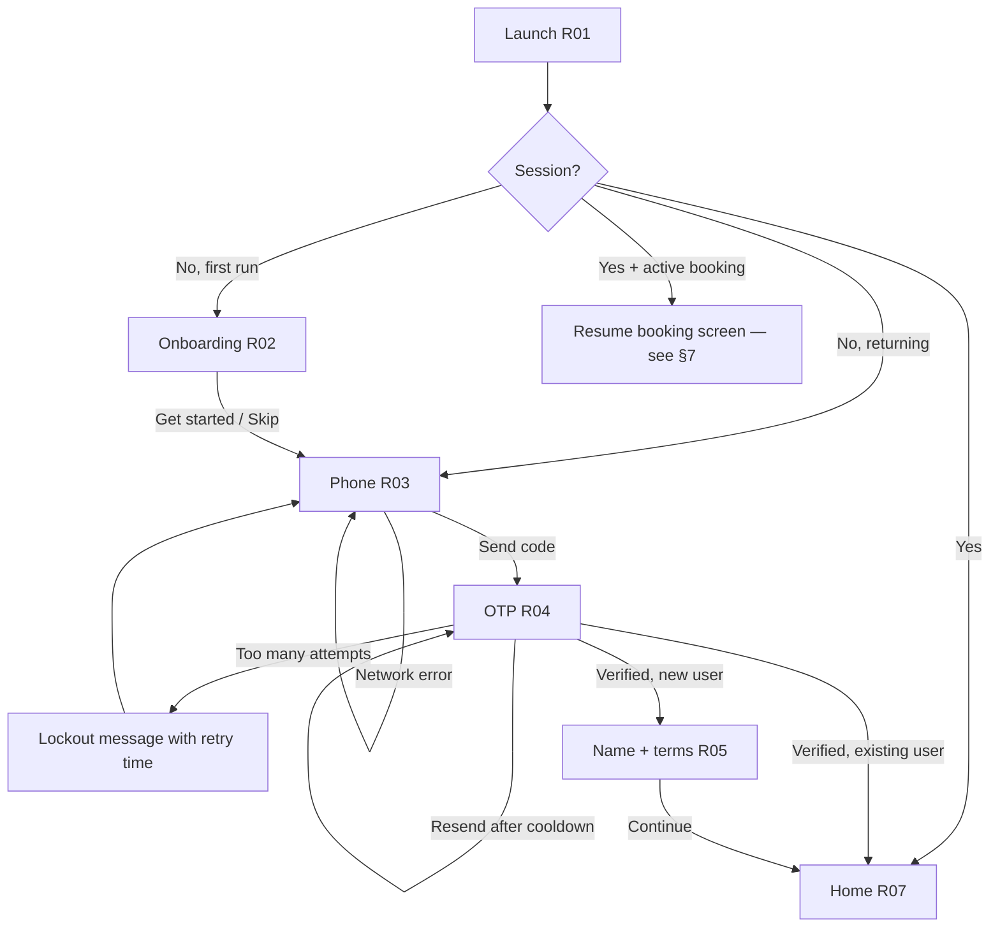

| Step | Failure | Handling |
|---|---|---|
| R03 Send code | Invalid format | Inline error; button disabled |
| R03 Send code | Network/server error | Error toast + retry; input kept |
| R04 Verify | Wrong code | Inline error; field cleared |
| R04 Verify | Expired code | "Code expired — resend" |
| R05 | Terms not accepted | Continue disabled |

## 2. Rider — location permission (R06, R07, R08)

Location is requested when the rider engages pickup (not at launch). R06 has a **single "Continue" button** (Apple HIG: pre-permission screens must not offer a decline option that duplicates the system prompt). Manual pickup entry is offered on **Home and search** when permission is denied or restricted — not on R06.

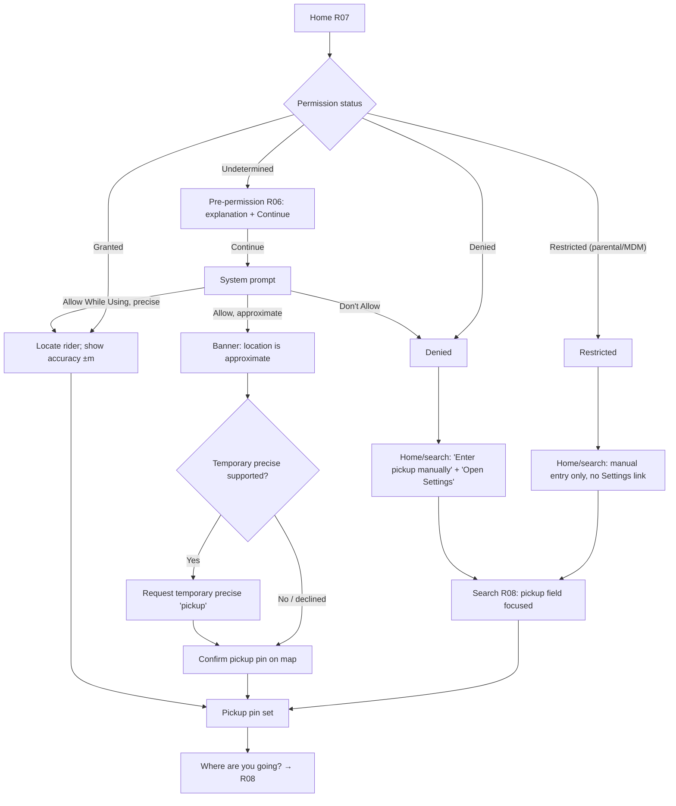

| Outcome | UI | Booking possible? |
|---|---|---|
| Granted precise | Blue dot, accuracy label | Yes |
| Granted approximate | Approximate banner, pin confirmation required | Yes (after confirm) |
| Denied | Manual pickup; Settings link | Yes |
| Restricted | Manual pickup; explanation without Settings link | Yes |
| Location services off (device) | "Turn on Location Services" + manual entry | Yes |
| GPS timeout | "Couldn't find you" + retry + manual entry | Yes |

## 3. Rider — Quick Match: booking through rating

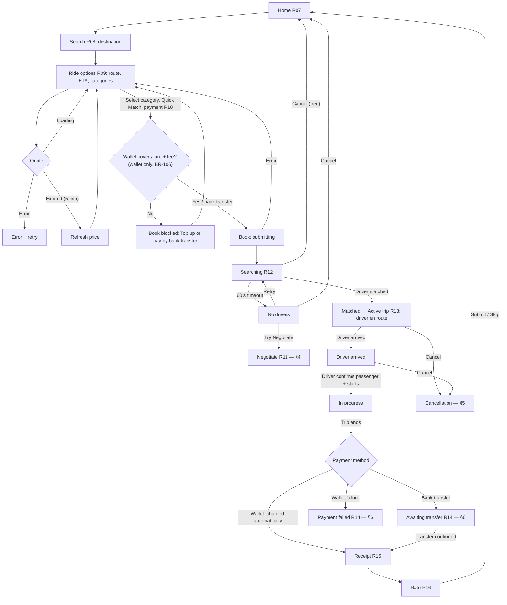

## 4. Rider — Negotiate

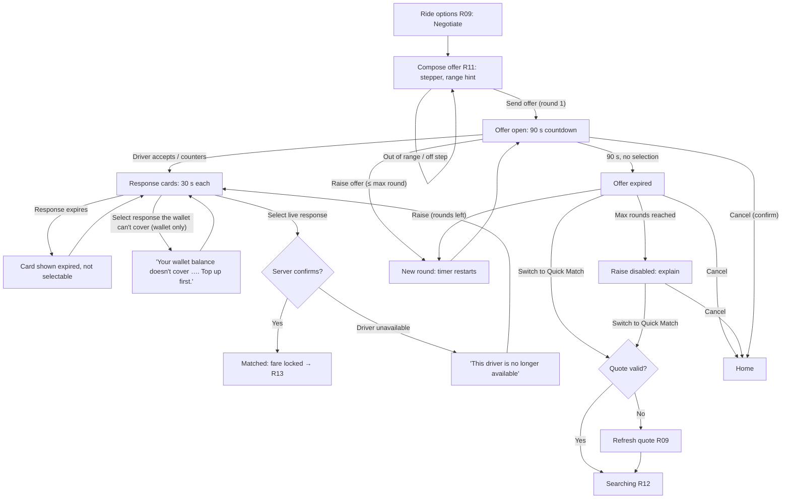

| Situation | Rule | Behaviour |
|---|---|---|
| Offer below min / above max | BR-040 | Stepper clamps; typed value shows range message |
| Lowering an open offer | BR-048 | Decrement disabled below current offer |
| Counteroffer | BR-043 | Shown with amount and difference vs offer |
| Same driver responds again | BR-045 | Card replaced, not duplicated |
| Response expiry after offer expiry | Q-029 | Assumed selectable until its own `expiresAt` |
| Rounds | BR-049 | Max 3; round counter visible ("Round 2 of 3") |
| Back while offer open | FR-NEG-014 | "Cancel your offer?" confirmation |

## 5. Rider — cancellation (free vs fee)

Allowed from `quoted` through `driver_arrived`; not offered from `in_progress` onwards (`UI_STATES.md`).

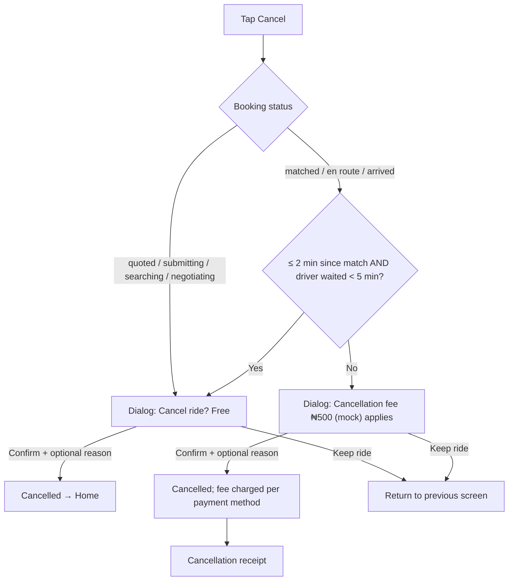

Driver-initiated cancellation after match: rider sees "Your driver cancelled" and is offered rematch (Quick Match) or cancel without fee (Q-030).

## 6. Rider — trip payment: wallet and bank transfer (R14)

*Revised 2026-10-21 (D-023): launch methods are GoBye Wallet and bank transfer; cards and cash removed from the flow (cash open, Q-001). Processing fees are shown as a separate line (BR-105). Bank-transfer details are simulated in this build ("GoBye Demo Bank", derived 10-digit number).*

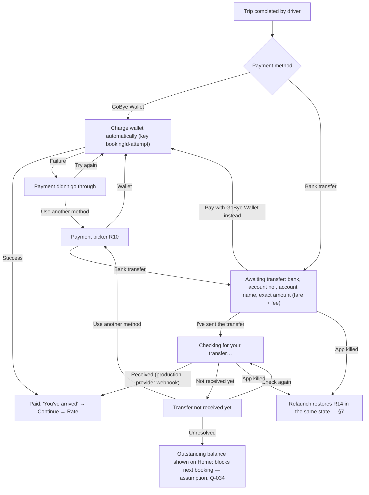

*Superseded (pre-2026-10-21): "Charge card/wallet", "Choose another card", "Pay with cash → driver confirms cash".*

## 7. State recovery after app kill

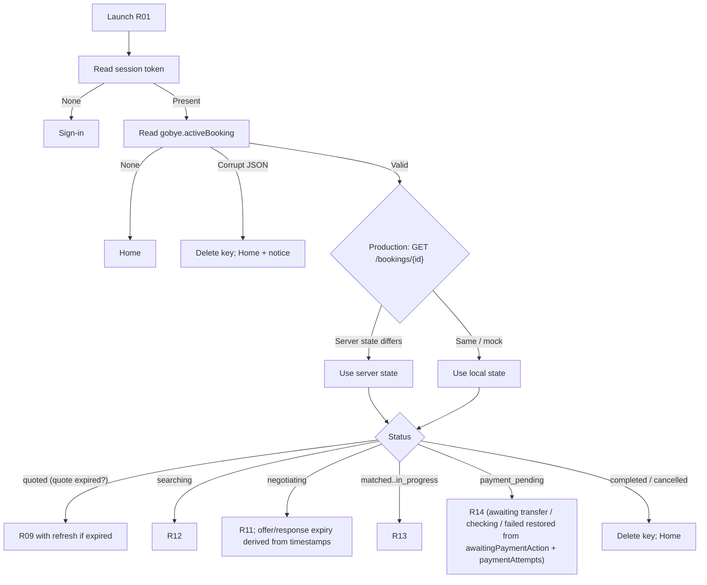

`submitting` at kill time: on relaunch the client re-sends the create request with the **same idempotency key** (production) so the server returns the original booking or creates it once.

## 8. Rider — account deletion (R28)

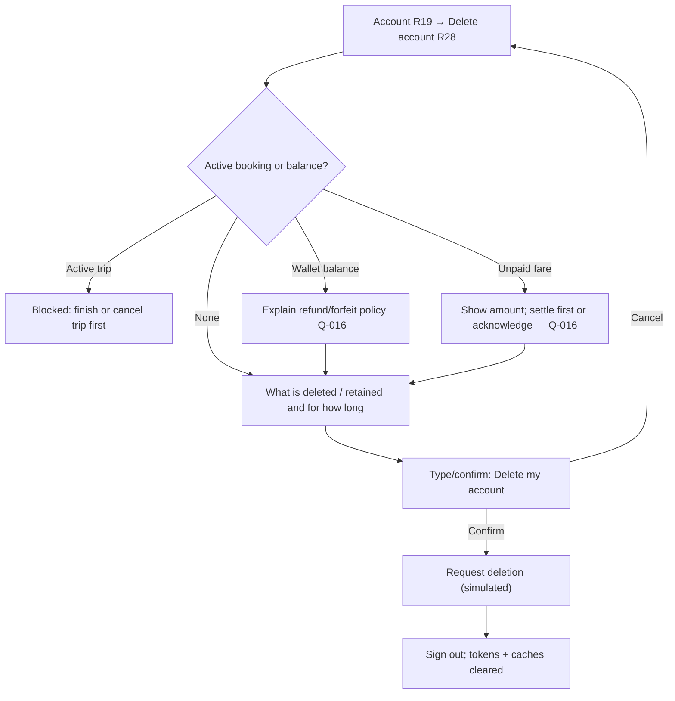

---

## 9. Driver — onboarding & verification (D01–D08)

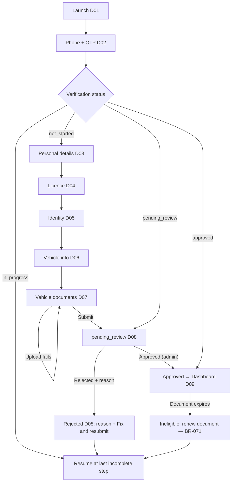

## 10. Driver — going online (D09, D10)

*Revised 2026-10-21 — D-026 (Q-012 resolved).* Going online requires eligibility, an **active access package** (BR-072) and **precise When In Use** location (BR-073). **"Always" is never requested automatically.** iOS keeps updating in the background because updates start in the foreground with `UIBackgroundModes: location` + `allowsBackgroundLocationUpdates`; Android uses a `location` foreground service started in the foreground (`ACCESS_BACKGROUND_LOCATION` only if device testing shows it is required). Logic: `driverLocationReducer` in `@gobye/core`; Driver UI not yet built.

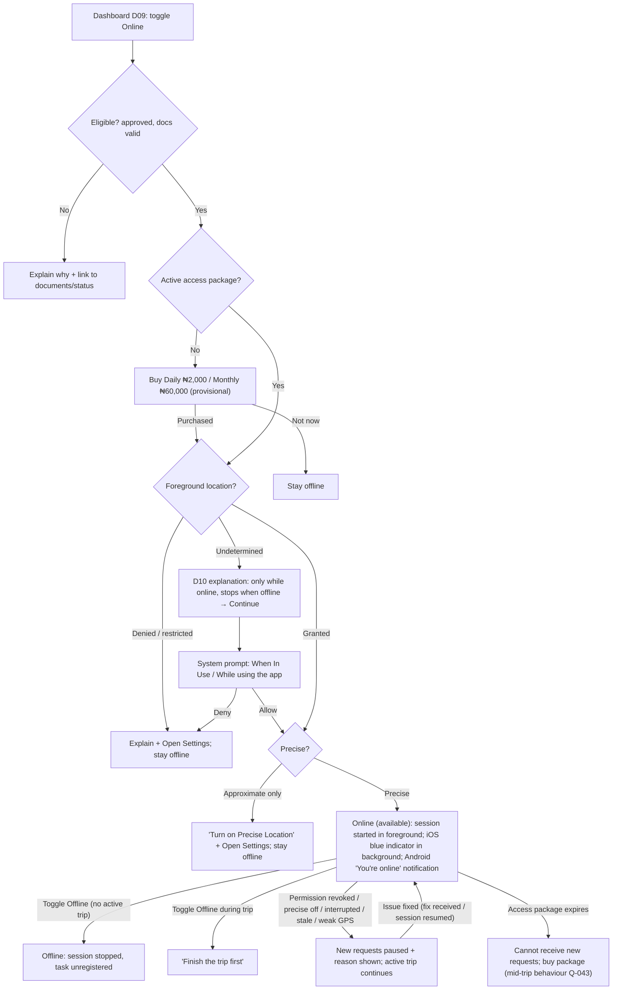

*Superseded (pre-2026-10-21): D10 → system prompt "Always / Allow all the time"; declined → "foreground-only or blocked (per Q-012)".*

## 11. Driver — receiving requests (D11, D12)

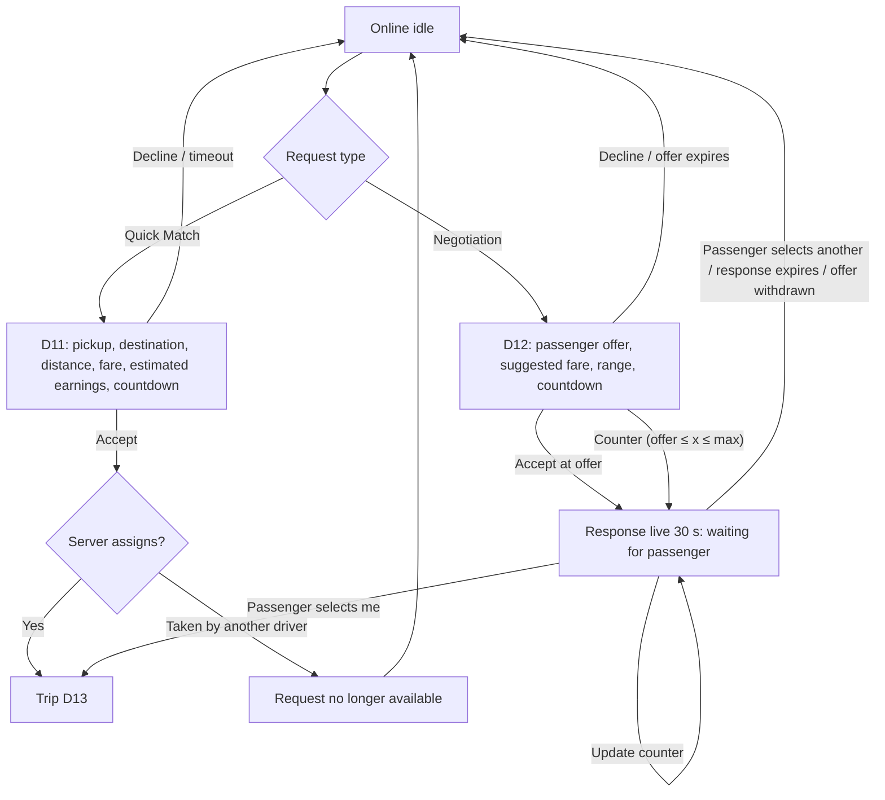

## 12. Driver — trip lifecycle (D13, D14)

```mermaid
flowchart TD
  A[Assigned: navigate to pickup] -- "Arrived" --> AR[Arrived: wait timer visible]
  AR -- "Confirm passenger name" --> CP[Passenger confirmed]
  CP -- "Start trip" --> IP[In progress: navigate to destination]
  IP -- "Complete trip" --> CMP[Trip complete D14]
  CMP -- "Cash (only if approved, Q-001)" --> CASH[Collect ₦X → confirm received]
  CMP -- "Wallet / bank transfer" --> DIG{Payment result}
  DIG -- "Paid" --> EARN["Estimated earnings shown (full fare, 0% commission)"]
  DIG -- "Awaiting transfer / failed" --> PEND[Payment pending: rider resolving]
  CASH --> EARN
  PEND -- "Rider pays / switches to wallet" --> EARN
  EARN --> ON[Back online — available (driver stays online until they go offline)]
  A -- "Cancel (reason + reliability warning)" --> ON
  AR -- "Rider no-show after wait → cancel" --> ON
  AR -- "Rider cancels" --> ON
```

## 13. Driver — payouts (D15)

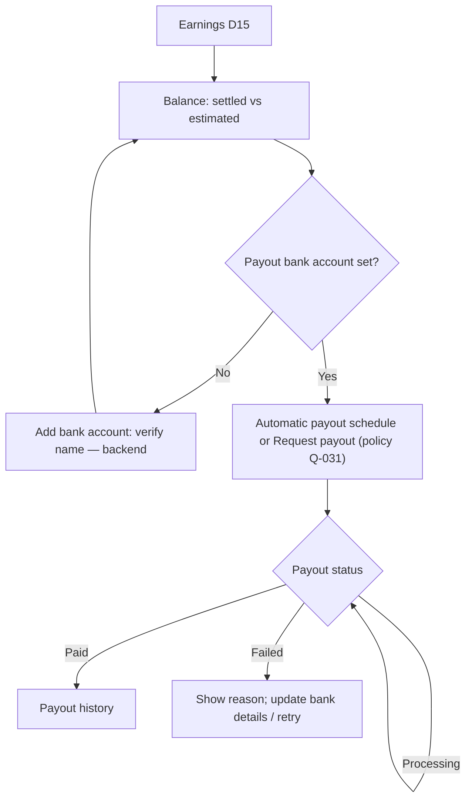

Cash trips: commission owed to the platform is netted against digital earnings or shown as balance due (Q-034). *(Superseded 2026-10-21: commission is 0% (D-024) and cash is not a launch method (D-023). Drivers pay for access packages instead — billing method Q-043.)*
